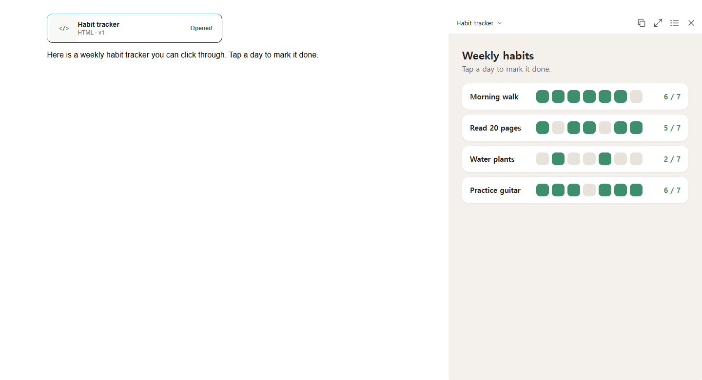
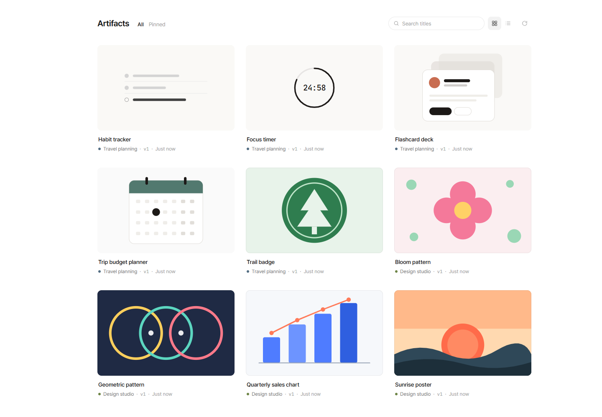

# Paseo Artifact Viewer

Preview HTML, SVG, and React beside your [Paseo](https://github.com/getpaseo/paseo) conversation. Open the version attached to an agent's reply, then find it again in the Artifacts library.

[User guide](docs/overview.md) · [한국어 안내](docs/overview.ko.md) · [Releases](https://github.com/shotgun1107/paseo-artifact-viewer/releases) · [Contributing](CONTRIBUTING.md)

## Install

Use Paseo desktop or web with a daemon running Paseo **0.16.1 through 0.17.x** and a Node runtime with SQLite support. Enable trusted plugins on the daemon, then install the [published release](https://www.npmjs.com/package/paseo-artifact-viewer/v/0.9.3).

~~~sh
paseo plugin add npm:paseo-artifact-viewer@0.9.3
~~~

Install from GitHub

~~~sh
paseo plugin add git:shotgun1107/paseo-artifact-viewer --ref v0.9.3
~~~

For a folder install, extract the [release archive](https://github.com/shotgun1107/paseo-artifact-viewer/releases/tag/v0.9.3) and select its `package` directory.

## Use it in Paseo

- **From a conversation** — Ask the agent to make an artifact. Click the card under its reply to open that version alongside the chat. In an older conversation, run `/artifact-guide` to give the agent the publishing instructions.
- **From the library** — Select **Artifacts** in the sidebar or run `/artifact`. Search across conversations on the same daemon, pin results, export the source, or restore an earlier version as a new revision.

See the Artifacts library

## Data and previews

The daemon stores artifacts locally in SQLite. New agents receive a publishing guide in their stored instructions. HTML and SVG previews start with external resources blocked. In-app React previews send source to CodeSandbox after consent. See the [user guide](docs/overview.md) for storage, external requests, and platform limits.

## Development

See [CONTRIBUTING.md](CONTRIBUTING.md) for the source layout, local checks, and package build. The code is [MIT-licensed](LICENSE). Bundled dependencies and design references are listed in the [third-party notices](docs/third-party-notices.md).
